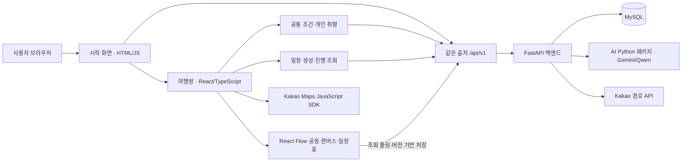

# 충북 여행 계획 · Frontend

여행방에서 각자의 취향을 모으고, 생성된 여행 일정을 함께 편집하는 **충북 단체여행 플래너**의 프론트엔드입니다.

## 목차

- [프로젝트 개요](#프로젝트-개요)
- [기술 설계 및 선택 (ADR)](#기술-설계-및-선택-adr)
- [아키텍처 다이어그램](#아키텍처-다이어그램)
- [실행 방법](#실행-방법)
- [확인 방법](#확인-방법)
- [디렉터리 구조](#디렉터리-구조)
- [상세 문서](#상세-문서)

## 프로젝트 개요

단체여행의 공통 조건과 개인별 선호·회피 조건을 한곳에서 확인하고, AI가 만든 초안을 공동 캔버스에서 조정할 수 있게 합니다. AI 해석 결과는 사용자가 수정·확인하며, 일정 생성과 저장의 권한·최신성은 백엔드가 검증합니다.

### 주요 기능과 사용자 흐름

1. **여행방 시작**: 기기 세션으로 방을 만들거나 초대 코드로 참여합니다.
2. **여행 준비**: 방장은 지역·날짜·인원·예산·교통·출발 조건을 설정합니다.
3. **내 취향 확인**: 각자 자유 입력을 AI로 분석하고, 선호·회피·식사·걷기 제한·예약/약속을 수정한 뒤 준비를 완료합니다.
4. **일정 생성**: 방장이 최신 준비 상태로 생성을 요청하고 진행 상황을 확인합니다.
5. **공동 편집**: 결과를 같은 여행방의 캔버스로 가져와 장소·댓글·연결·날짜·배치를 함께 편집하고 일정표로 확인합니다.

개인 원문·해석 근거·개인 일정은 본인에게만 표시합니다. 방장이 공통 일정으로 지정한 예약·약속만 그룹 코스의 고정 기준점으로 사용합니다. 조건이 변경되면 재확인을 안내합니다.

캔버스의 장소·댓글·연결·날짜·배치는 공동 저장합니다. **구간별 이동수단과 직접 입력한 이동시간은 브라우저별 로컬 설정**이며, 다른 참여자나 다른 브라우저에 공유되지 않습니다.

### 대표 화면

| 여행 준비·취향 확인 | 일정 캔버스·장소 추천 |
| --- | --- |
|  |  |

출처는 [W17 아카이빙 자료](https://github.com/woowangthon/hub/tree/W17/archive)이며, 위 이미지는 [2026-11-15 확인한 원본 커밋](https://github.com/woowangthon/hub/tree/5aa37a24afbb8d584d5eb58f7bca25c5060692f1/archive)에 고정되어 있습니다. 아카이빙 화면의 표시값은 해당 캡처의 예시이며, 현재 실행 환경의 API·경로·동시 편집 검증은 아래 확인 절차를 따릅니다.

### 저장소 역할

| 저장소 | 담당 |
| --- | --- |
| **이 저장소 · FE** | 시작 화면, 준비·취향 입력, 생성 진행, 공동 캔버스와 일정 표시 |
| [BE](https://github.com/woowangthon/WOOWANGTHON_TEAM_17_BE) | 인증·권한, DB 저장, 조건 버전, 후보 선정·최적화, 실제 경로 검증 |
| [AI](https://github.com/woowangthon/WOOWANGTHON_TEAM_17_AI) | Gemini/Qwen 취향 분석, 후보 기반 일정 초안, 모델 학습·평가 |

## 기술 설계 및 선택 (ADR)

아래는 현재 코드와 설계 문서를 기준으로 정리한 결정 요약입니다. 초기 구성의 이력은 [기존 결정 기록](docs/decisions.md)을 참고합니다.

| ADR | 선택 | 이유와 트레이드오프 |
| --- | --- | --- |
| FE-01 · 화면 구성 | React 19 + TypeScript, Vite 8, Tailwind CSS 4 | 화면 조립·기능별 상태/API·공통 UI를 분리하고 타입 검사와 빠른 개발 빌드를 사용합니다. 기본 시작 화면은 기존 HTML/JavaScript를 유지하므로 React 화면과 두 진입 방식을 함께 관리합니다. |
| FE-02 · 공동 편집 | React Flow (`@xyflow/react`) + revision 기반 동기화 | 장소·댓글·연결을 노드/간선으로 표현합니다. 보이는 화면에서 약 1초마다 변경을 조회하고 충돌 시 선택을 요구합니다. 폴링 지연과 요청 비용이 있으며 동시 편집 충돌이 자동으로 모두 병합되지는 않습니다. |
| FE-03 · 서버 통신 | 같은 출처의 `/api/v1` + 기기 쿠키 | 개발에서는 Vite 프록시, 통합 확인에서는 BE의 정적 파일 서빙을 사용합니다. FE가 DB나 AI 키를 보유하지 않습니다. 호스트·Origin·쿠키 설정을 맞춰야 합니다. |
| FE-04 · AI와 확정 분리 | 분석 결과 저장과 사용자 준비 완료를 구분 | AI가 해석한 조건을 직접 수정하고 확인하도록 합니다. CV/PV(공통 조건/개인 취향 버전)를 대조하며, 입력이 바뀌면 다시 확인해야 합니다. 별도 태그 재검토 화면은 새 생성 흐름의 필수 단계가 아닙니다. |
| FE-05 · 저장 충돌 보호 | `expectedRevision` + `expectedSourcePlan` + 멱등 키 | 오래된 편집이나 이전 생성 결과의 저장이 새 캔버스를 덮어쓰지 않게 합니다. 서버 저장 실패·충돌은 사용자에게 표시하며 정상 여행방을 로컬 예시로 대체하지 않습니다. |
| FE-06 · 디자인과 시안 | 공통 컴포넌트·디자인 토큰, 명시적인 preview 진입 | 입력·버튼·모달과 색상을 재사용합니다. 서버 없는 시안은 실제 여행방 저장과 분리하므로 시안 확인만으로 API 연동을 검증할 수 없습니다. |

## 아키텍처 다이어그램



개발 시 `브라우저 :5173 → Vite /api 프록시 → BE :8000`, 통합 확인 시 `브라우저 :8017 → BE가 FE dist와 API 제공` 구조입니다. 두 실행 방식은 아래에서 하나를 선택합니다.

## 실행 방법

### 1. 사전 준비

- Node.js **24.x**, npm **11.x**. 개발 기준은 Node 24.15.0 / npm 11.12.1입니다. 지원 범위는 [package.json](package.json)의 `engines`를 따릅니다.
- npm과 `package-lock.json`을 사용합니다. `.node-version`은 사용하지 않습니다.
- Web Locks API와 쿠키·`localStorage`·`sessionStorage`를 사용할 수 있는 최신 브라우저가 필요합니다. Chrome 또는 Edge를 권장하며, 브라우저 저장 공간을 차단하면 기기 연결·방 생성/참여가 제한될 수 있습니다.
- 실제 기능 확인에는 인접한 BE·AI 저장소, 준비된 MySQL 스키마와 장소 데이터가 필요합니다. [BE 실행 안내](https://github.com/woowangthon/WOOWANGTHON_TEAM_17_BE#readme)를 먼저 확인합니다.

권장 폴더 배치:

```text
작업폴더/
  WOOWANGTHON_TEAM_17_FE/
  WOOWANGTHON_TEAM_17_BE/
  WOOWANGTHON_TEAM_17_AI/
```

### 2. 환경변수

지도가 필요하면 FE 루트에서 `.env.example`을 `.env.local`로 복사하고 브라우저용 키를 설정합니다. 아래 명령은 기존 파일을 보존합니다.

```powershell
if (-not (Test-Path .env.local)) { Copy-Item .env.example .env.local }
```

| 설정 | 위치·용도 |
| --- | --- |
| `VITE_KAKAO_JAVASCRIPT_KEY` | FE `.env.local`. 지도 SDK용 키이며 실제 접속 Origin을 Kakao JavaScript SDK 도메인에 등록합니다. |
| `ALLOWED_ORIGINS` | BE `.env`. 개발은 `http://127.0.0.1:5173`, 통합 확인은 `http://127.0.0.1:8017`을 포함합니다. |
| DB·Gemini·Kakao REST 키 | BE/AI에서만 설정합니다. `VITE_*` 값은 브라우저 번들에 포함되므로 비밀값을 넣지 않습니다. |

FE 환경변수를 변경하면 개발 서버를 다시 시작하거나 빌드를 다시 수행합니다. 지도 키·도메인 설정이 없으면 지도 표시는 확인할 수 없습니다.

### 3-A. FE 개발 서버

FE 루트에서 실행합니다. BE는 별도 터미널에서 **8000 포트**로 실행해야 합니다.

```powershell
npm ci
npm run dev
```

[개발 화면](http://127.0.0.1:5173/)에 접속합니다. `/api`는 `http://127.0.0.1:8000`으로 전달됩니다. `localhost`와 `127.0.0.1`을 섞으면 쿠키·Origin이 달라질 수 있으므로 한 주소를 유지합니다.

### 3-B. FE·BE 통합 확인

FE 루트에서 빌드한 후 인접 BE의 가상환경으로 실행합니다. BE 환경·DB·AI 설치는 해당 README에 따라 먼저 준비합니다.

```powershell
npm ci
npm run build
..\WOOWANGTHON_TEAM_17_BE\.venv\Scripts\python.exe ..\WOOWANGTHON_TEAM_17_BE\run.py
```

[통합 화면](http://127.0.0.1:8017/)에 접속합니다. `run.py`는 기본적으로 인접 FE의 `dist/`를 사용합니다. 다른 폴더는 BE의 `FRONTEND_DIR`로 지정합니다. `dist/`는 생성물이며 Git에 포함하지 않습니다.

### 서버 없이 화면 보기

개발 서버에서 [여행방 시안](http://127.0.0.1:5173/room.html?preview=room), [공통 UI 시안](http://127.0.0.1:5173/?preview=ui)을 엽니다. 시안은 실제 생성·저장·공유를 하지 않습니다. 기본 `/`의 실제 방 생성·참여에는 BE가 필요합니다.

## 확인 방법

### 자동 검사

FE 루트에서 실행합니다.

```powershell
npm run check
npm test
```

| 명령 | 확인 대상 |
| --- | --- |
| `npm run typecheck` | 앱·설정의 TypeScript 타입 |
| `npm run lint` | Oxlint 정적 검사 |
| `npm run build` | 타입 검사 후 시작·여행방·공통 UI 페이지 빌드 |
| `npm run check` | 타입·lint·빌드 순서대로 실행 |
| `npm test` | Node 테스트 러너로 API adapter·준비 상태·생성 흐름·캔버스 동기화 등 검사 |
| `npm run preview` | 빌드 정적 결과 확인. 실제 API 통합은 위 3-A/3-B 방식으로 확인 |

### 수동 확인 시나리오

| 순서 | 확인할 결과 |
| --- | --- |
| 방 만들기·초대 참여 | 방 생성 후 초대 코드가 표시되고, 다른 브라우저/프로필로 같은 방에 참여합니다. |
| 취향 분석·직접 확인 | AI 결과를 수정·저장하고 준비 완료합니다. 다른 참여자에게 개인 원문이 보이지 않아야 합니다. |
| 공통 조건 변경 | 이전 준비 완료 상태에 재확인이 표시되고 미저장 입력이 유실되지 않아야 합니다. |
| 방장 일정 만들기 | 생성 진행이 표시되고 성공 결과가 공동 캔버스로 연결됩니다. 실패는 오류로 안내합니다. |
| 공동 편집·충돌 | 두 브라우저의 장소·댓글·배치 변경이 반영되고, 충돌은 안내되며 새로고침 후 서버 저장 내용이 복원됩니다. |
| 경로·지도 | 키가 준비되면 지도·실제 이동 구간을 확인합니다. 경로/요금 미확인 항목이 확정값처럼 표시되지 않아야 합니다. |

빌드·단위 검사와 실제 브라우저/API 확인은 별개입니다. 실제 연동 검수에는 BE migration **001~005**의 기능별 준비 상태, AI 제공자, 경로 키가 필요합니다. 테스트 결과나 과거 검수 기록을 현재 환경의 실행 성공으로 간주하지 않습니다.

## 디렉터리 구조

```text
index.html / public/assets/live-entry/  실제 시작 화면·기기 세션 API
room.html / src/room-main.tsx           React 여행방 진입
ui-preview.html / src/main.tsx         공통 UI 확인용 진입
src/pages/                             화면 조립
src/features/room, preparation/         공통 여행 조건·준비 상태
src/features/personal/                  개인 취향·원자 조건 v2 확인
src/features/generation/                생성 요청·진행·캔버스 가져오기
src/features/workspace/                 캔버스·동기화·경로·일정표
src/components/                        공통 UI·여행 컴포넌트
src/styles/                            디자인 토큰·화면 스타일
tests/                                 Node 기반 자동 검사
docs/                                  설계·계약·검수 기록
```

`src/features/entry`의 mock은 보존된 예시이며 기본 시작 화면과 구분합니다.

## 상세 문서

- 현재 흐름: [준비부터 공동 캔버스까지](docs/preparation-schedule-design.md), [직접 확정과 준비 상태](docs/preparation-confirmation-review.md), [조건 변경 안내](docs/preparation-condition-notice.md)
- 공동 편집: [공동 캔버스](docs/canvas-studio.md), [생성 결과 통합](docs/canvas-generation-integration.md), [캔버스 일정표](docs/canvas-itinerary.md)
- 실행·검수: [시작 화면 실행](docs/trip-entry.md), [준비·생성 검수](docs/preparation-generation-validation.md), [3인 생성 검수 기록](docs/three-person-generation-review.md)
- 개발 기준: [API 계약](docs/api-contract.md), [UI 가이드](docs/ui-guide.md), [공통 UI](docs/common-ui.md)
- 팀 작업: [AGENTS.md](AGENTS.md), [에이전트 운영](docs/orchestration.md), [GitHub 절차](docs/github-workflow.md), [팀 스킬](docs/skills.md)

상세 문서의 날짜별 검수·이전 화면 설명은 해당 시점의 기록입니다. 현재 동작은 최신 코드와 기능별 계약을 기준으로 확인합니다.
