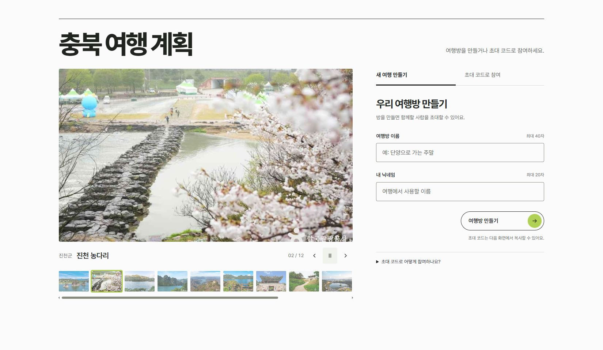
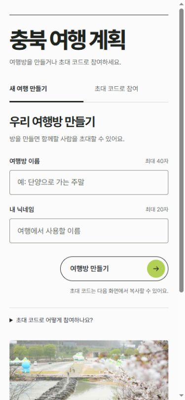
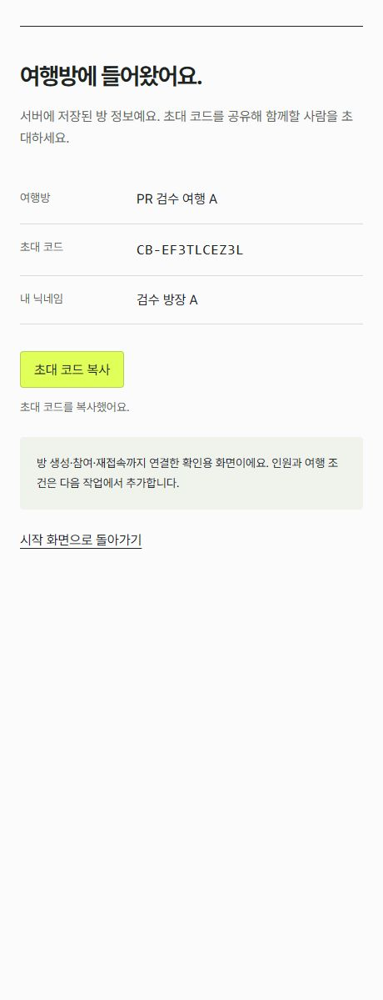

# 여행방 시작 화면 실행과 검수

검수한 시작 화면은 `index.html`, 방 진입 인계 화면은 `room.html`입니다. 기존 HTML의 디자인·입력 배치·오른쪽 생성 버튼·사진 슬라이드를 유지하고 하단 푸터만 제거했습니다. 스타일·사진·폰트·API 모듈은 `public/assets/live-entry/`에서 관리합니다. 이 시작 화면을 React로 재작성하지 않았으며 기존 React 공통 UI는 `ui-preview.html?preview=ui`에서 보존합니다. `/`에 `?preview=ui`를 붙여도 그 화면으로 이동합니다.

## 파이참으로 함께 실행

```text
workspace/
  WOOWANGTHON_TEAM_17_FE/
  WOOWANGTHON_TEAM_17_BE/
```

1. 두 저장소를 같은 상위 폴더에 준비합니다. BE의 [여행방 API PR #9](https://github.com/woowangthon/WOOWANGTHON_TEAM_17_BE/pull/9)와 이 FE 변경이 필요합니다.
2. FE 폴더에서 `npm ci`, `npm run build`를 실행합니다. Node 24.x와 npm 11.x를 사용합니다.
3. BE는 README에 따라 Python 3.12 환경과 개인 `.env`, 대상 DB의 지원 테이블 적용 여부를 확인합니다. 실제 연결 정보는 FE나 Git에 넣지 않습니다.
4. 파이참에서 BE의 `run.py`를 BE 전용 `.venv/Scripts/python.exe`로 실행합니다. 상위 폴더의 다른 `.venv`와 구분합니다.
5. `http://127.0.0.1:8017/`을 엽니다. FE 변경 후에는 다시 빌드하고 브라우저를 새로고침합니다. 기존 서버가 있으면 하나만 실행합니다.

BE의 `run.py`는 인접 FE의 `dist`를 기본으로 사용합니다. 다른 폴더는 BE 환경변수 `FRONTEND_DIR`로 지정합니다. `dist`와 `node_modules`, 개인 `.env`, Python 가상환경은 Git에서 제외합니다. 임시 작업 폴더나 예전 데모 디렉터리는 실행에 필요하지 않습니다.

## FE를 수정하면서 실행

BE 폴더에서 API 전용 서버를 실행합니다.

```powershell
.\.venv\Scripts\python.exe -m uvicorn app.main:app --env-file .env --host 127.0.0.1 --port 8000
```

FE 폴더에서 `npm run dev`를 실행하고 `http://127.0.0.1:5173/`을 엽니다. Vite는 `/api`를 `http://127.0.0.1:8000`으로 전달합니다. BE `ALLOWED_ORIGINS`에 `http://127.0.0.1:5173`을 포함해야 하며 Origin은 프록시에서 바꾸지 않습니다. 배포 시에도 FE와 `/api`는 같은 출처에서 제공해야 합니다. 단순 정적 호스팅만으로 API가 준비되지는 않습니다.

## 검수 범위

- 새 방 이름·닉네임 입력 → 생성 → 별도 방 진입 화면의 서버 정보·초대 코드 확인
- 새로고침 후 같은 본인으로 재접속, 코드 복사 성공 또는 직접 복사 안내
- 다른 브라우저에서 초대 코드·다른 닉네임으로 참여, 같은 기기는 기존 본인 유지
- 잘못된 입력·없는 코드·서버 오류에서 입력과 오류 안내 유지, 처리 중 중복 제출 방지
- 두 탭 초기 세션 연결, 응답 유실 뒤 같은 요청 키 재사용, 다른 탭의 연결 변경 뒤 불확실 요청 재전송 차단
- 데스크톱/모바일, 키보드 탭 전환·입력, 슬라이드 이전/다음/일시정지와 움직임 줄이기 설정

요청은 `/api/v1/device-session`, `/api/v1/trips`, `/api/v1/trip-memberships`, `/api/v1/trips/{tripId}/reconnect`를 사용합니다. 기기 자격은 HttpOnly 쿠키에만 두고 JavaScript에서 읽지 않습니다. 브라우저 저장소의 요청 키·연결 변경 표시는 재시도 제어용이며 서버 권한을 부여하지 않습니다. 불확실한 요청은 만료·연결 변경 뒤 자동으로 새 방을 만들지 않습니다. 전체 계약은 [여행방 시작](https://app.notion.com/p/40ee977e49088105a9b4ce4df0aef6f8)과 [공통 규칙](https://app.notion.com/p/40ee977e49088189b512e6e817984d48)을 따릅니다.

최근 목록 UI·방 내부 인원/날짜/예산/출발 시간/이동수단 설정·AI 일정 생성은 포함하지 않습니다. 브라우저에서 생성·참여하면 연결된 DB에 저장됩니다. 자동 검사와 샘플 방 생성은 공용 DB 대신 격리 테스트 DB에서만 수행합니다.

## 검증 결과

최종 구현에서 `npm test` 17개와 `npm run check`의 타입·lint·빌드 검사를 통과했습니다. 별도 MySQL `127.0.0.1:3317/osami_entry_test`를 연결한 서버에서 두 탭 동시 생성·각 방으로 이동·새로고침 재접속·코드 복사, 다른 브라우저의 없는 코드 오류와 입력 유지·정상 참여·같은 기기 재참여 시 닉네임 유지까지 확인했습니다. DB에서 생성 방 2개, 방장 2명과 신규 참여자 1명, 같은 브라우저 방장의 공통 기기 세션, 미정 여행 조건 NULL을 확인했습니다. 공용 `chungbuk_trip1`에는 이 검수 데이터를 만들지 않았습니다.

브라우저에서 확인한 native fetch 호출 오류를 수정하고 회귀 검사를 추가했습니다. 독립 검토에서 지적한 재시도 키 유지·저장소 거부·다른 탭의 세션 변경 뒤 불확실 재전송 문제도 수정·재검토했습니다. 데스크톱과 390px 모바일, 입력 길이 오류·키보드 탭 전환·기존 공통 UI 경로를 확인했습니다. 기존 시안의 사진·폰트 13개 파일은 원본 포함 바이트와 해시가 동일합니다.





## 사진과 폰트 출처

사진은 기존 검수 시안에 포함된 `chungbuk_trip1.places`의 관광지 사진 12장을 그대로 사용합니다. 화면을 열 때마다 DB에서 사진 목록을 조회하는 API는 없습니다. 한국관광공사 이미지 원본 목록은 다음과 같으며 재압축하지 않고 파일로 분리했습니다.

| 장소 | 원본 |
| --- | --- |
| 도담삼봉 | [한국관광공사](https://tong.visitkorea.or.kr/cms/resource/29/4085729_image2_1.jpg) |
| 충주호 | [한국관광공사](https://tong.visitkorea.or.kr/cms/resource/95/3560695_image2_1.JPG) |
| 제천 의림지와 제림 | [한국관광공사](https://tong.visitkorea.or.kr/cms/resource/09/3309809_image2_1.JPG) |
| 수옥폭포 | [한국관광공사](https://tong.visitkorea.or.kr/cms/resource/01/4084901_image2_1.jpg) |
| 소백산국립공원(북부) | [한국관광공사](https://tong.visitkorea.or.kr/cms/resource/08/3571608_image2_1.jpg) |
| 단양 구담봉·옥순봉 | [한국관광공사](https://tong.visitkorea.or.kr/cms/resource/68/176668_image2_1.jpg) |
| 청주 상당산성 | [한국관광공사](https://tong.visitkorea.or.kr/cms/resource_photo/57/3504257_image2_1.JPG) |
| 진천 농다리 | [한국관광공사](https://tong.visitkorea.or.kr/cms/resource/05/4058305_image2_1.JPG) |
| 청풍문화유산단지 | [한국관광공사](https://tong.visitkorea.or.kr/cms/resource/42/3331142_image2_1.jpg) |
| 괴산호 | [한국관광공사](https://tong.visitkorea.or.kr/cms/resource/37/3571237_image2_1.jpg) |
| 박달재자연휴양림 | [한국관광공사](https://tong.visitkorea.or.kr/cms/resource/39/3061139_image2_1.JPG) |
| 월악산국립공원 | [한국관광공사](https://tong.visitkorea.or.kr/cms/resource/17/3494917_image2_1.jpg) |

Pretendard 폰트는 배포 파일과 함께 `public/assets/live-entry/LICENSE.txt`의 SIL Open Font License를 보존합니다.
